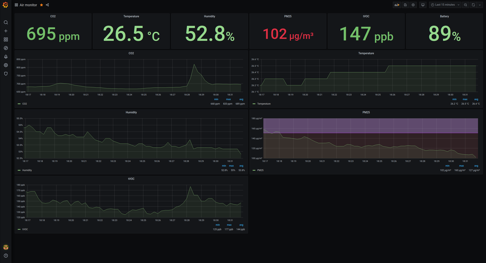

This project is copy paste from https://gist.github.com/cdump/af1b082acbdee73a6bdba525b0688208 and https://habr.com/ru/post/482352/#comment_21087180

The container uses Python 3.13.18 on Debian Bookworm, whose compiler remains
compatible with the existing `netifaces` dependency. Rebuild with `docker build --pull` and
redeploy to pick up the eMudhra certificate fix and patched dependencies;
restarting an existing container does not update its runtime or CA bundle.
Verify sensor readings after upgrading the runtime.

## Grafana

[Link to grafana dashboard](https://grafana.com/grafana/dashboards/14586)

